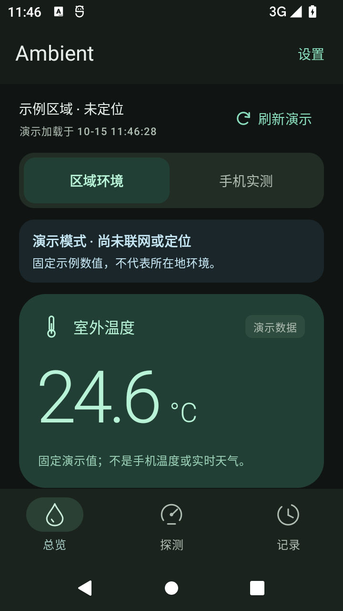
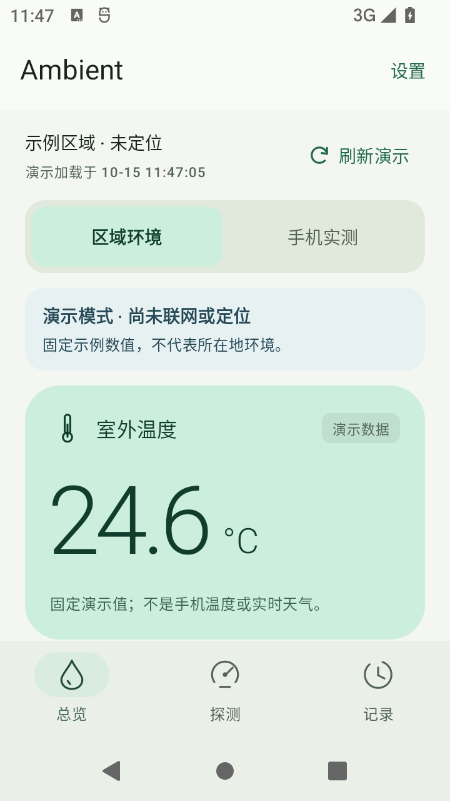
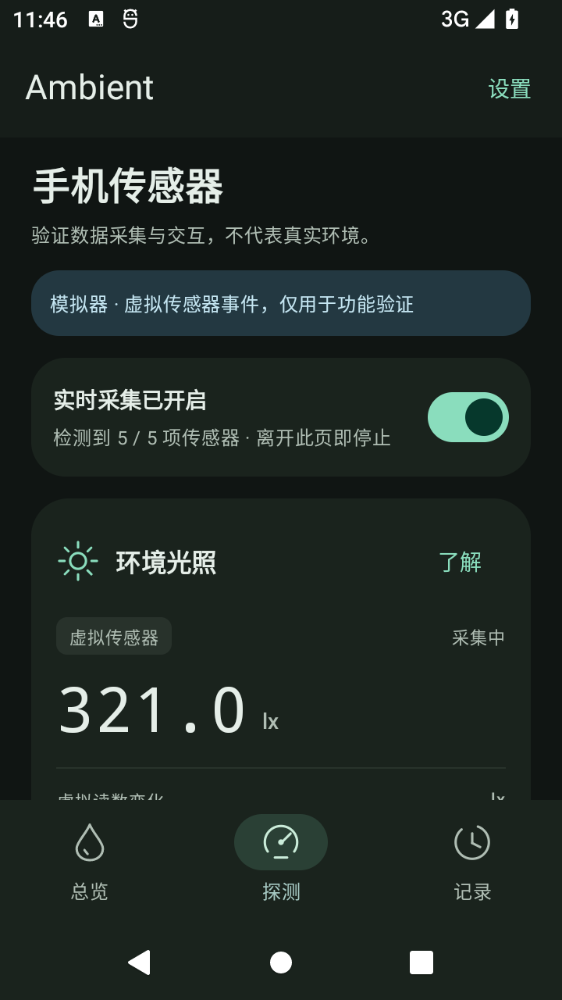
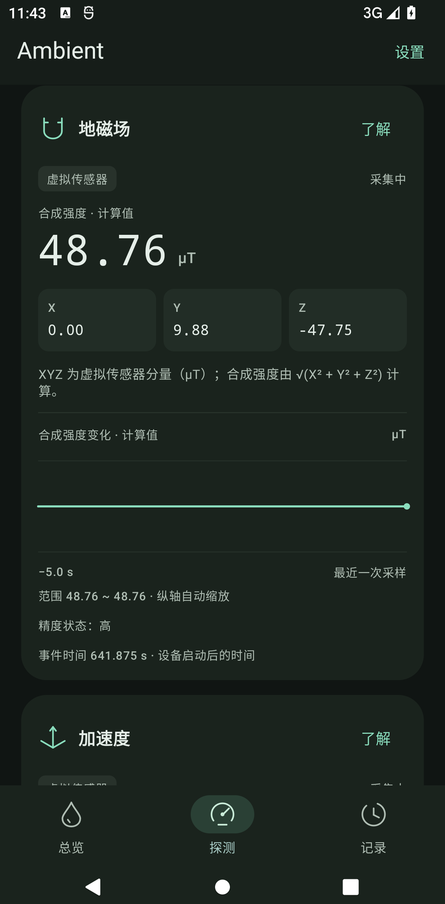

# 第一阶段验证记录

本页记录最初的 0.1.0 版本。标准 APK 路径现为 0.3.0；当前功能、校验信息与测试结果见 [加速度与定位速度验证](motion-validation.md)，主题记录见 [三套渐变主题验证](themes-validation.md)。

验证日期：2026-10-15。所有设备验证均在本项目独立 AVD 内完成，**没有将模拟器数值当作华为 Pura 70 Pro 实测**。

## 构建与工具

实际复用的已有工具：

- Temurin JDK 17.0.20.1，`L:\AI-Accounting\.tools\jdk17`，`java` / `javac` 均核对可执行。
- Android SDK：API 36 revision 2、Build Tools 35.0.0、Platform Tools 37.0.1。
- Gradle 8.13，完整 Wrapper、分发包与依赖缓存复制到 Ambient；分发包 SHA-256 与 Wrapper 声明一致。
- 构建版本：AGP 8.13.2、Kotlin 2.3.21、Compose BOM 2025.12.01、Lifecycle 2.10.0。
- Emulator 37.2.12 / WHPX、Android 12 API 31 x86_64 镜像，均为之前已安装的工具。

本次没有下载或安装大型工具，没有改系统 Java、PATH，没有改旧项目源码或旧 AVD。

执行 `scripts/build.ps1 -Offline`，包含 `assembleDebug testDebugUnitTest lintDebug`，实际输出 `BUILD SUCCESSFUL`。另强制重新运行 Lint，排除旧报告影响，最终报告为 `No issues found.`。Gradle 的可选 analytics 初始化提示用户目录不可写，但本次编译、测试、APK 签名和 Lint 均成功；没有为了该提示修改用户目录权限。

APK：`L:\Ambient\app\build\outputs\apk\debug\app-debug.apk`

- 大小：11,567,301 bytes（约 11 MiB）。
- SHA-256：`03222bb779819b82bc0338361f79bba98b7a37d99b8e22cc3e7e5aefb8ec5dba`。
- `apksigner verify --verbose` 通过，v2 签名有效；本阶段为 Debug 签名。
- APK 包名 `com.ambient.app`，minSdk 26 / targetSdk 36。
- APK 未声明 INTERNET、定位或高频传感器权限。AndroidX 自动生成的应用内部接收器权限不涉及用户授权。

## 单元测试：16 项通过

| 测试类 | 数量 | 验证内容 |
| --- | ---: | --- |
| SensorReadingAccumulatorTest | 8 | 三轴模长、连续事件节流、曲线 60 点上限、无效值清理、单调事件时戳、Long.MAX_VALUE 边界、光照末次变化与同值去重 |
| SensorsViewModelTest | 3 | 离页停止、不改用户暂停选择、不可见页不启动硬件 |
| CachedEnvironmentRepositoryTest | 3 | 失败保留缓存及加载时间、首次失败不造数据、取消异常传播 |
| DemoEnvironmentDataServiceTest | 2 | 固定 Clock、DEMO 来源、没有真实观测时间、海拔保持无数据 |

没有测试失败或错误。报告保存在 `app/build/reports/tests/testDebugUnitTest/`。

## 模拟器流程：8 项通过

设备 `emulator-5560`，AVD `Ambient_API_31`。测试由 `scripts/smoke-test-emulator.ps1` 执行，结合 UI 层级和系统 `dumpsys sensorservice` 检查实际监听注册状态。

1. APK 安装、冷启动成功；360 × 640 dp 首屏可见温度与演示标识，总览页没有 Ambient 传感器监听。
2. 通过模拟器输入光照 321 lx，UI 显示 321.0 lx，并标明“虚拟传感器”。这只验证事件链路。
3. 手动暂停后，系统内 Ambient 监听连接消失，UI 显示暂停。
4. 恢复后收到新输入的 456 lx 事件。
5. 按 Home 退后台后注销监听，返回探测页后重新注册。
6. 进入设置停止采集，切换浅色并终止/重启进程后外观选择仍保存。
7. 历史记录页正确显示后续阶段占位，页面导航可用且不采集传感器。
8. 最后运行中的 Ambient 进程没有 AndroidRuntime 致命异常。

附加视觉检查：

- 深色/浅色首页、探测页、设置页、记录页均查看实际截图。
- 360 × 640 dp 和约 420 × 853 dp 两种视口；较大视口实际为 1260 × 2560 / 480 dpi。模拟器将请求的更高高度限制到了 2560，未将其声称为 Pura 70 Pro 原屏复现。
- 大屏中 XYZ 分量、计算模长和事件时间曲线显示正常；曲线为实际虚拟事件形成的稳定直线，没有添加示例波动。
- 已启用系统手势导航（navigation_mode=2），从设置页侧滑返回总览成功，底部手势区域留白正常。

## 已知边界

- 未连接 Pura 70 Pro 真机；该机传感器清单、精度、功耗、厂商手势与后台行为尚待真机验收。
- 当前 AVD 提供五类传感器。没有在真实缺失传感器硬件上测试“不支持”分支；代码根据 `getDefaultSensor` 是否为空处理，未强行补值。无首事件状态已在测试过程中观察到，随后改变模拟器输入后正常显示。
- 没有接入 QWeather、真实定位或持久天气缓存；缓存测试仅验证当前内存仓库。海拔、朝向、倾斜角、Room 历史记录和 CSV 均未实现。
- Windows 的 `crashpad_handler.exe` 问题在旧项目文档中有相同记录。本项目启动前设置进程级 `ANDROID_EMU_ENABLE_CRASH_REPORTING=0`，并沿用软件 GPU；不修改其他应用的同名进程。API 31 / Emulator 37 的蓝牙兼容处理仅作用于本项目专用 AVD。

## 实际截图

| 首页深色 | 首页浅色 |
| --- | --- |
|  |  |

| 传感器 | 三轴与曲线 |
| --- | --- |
|  |  |

其他截图：`settings-light.png`、`history-dark.png`、`overview-large-dark.png`、`overview-gesture-dark.png`，均位于 `docs/screenshots/`。
