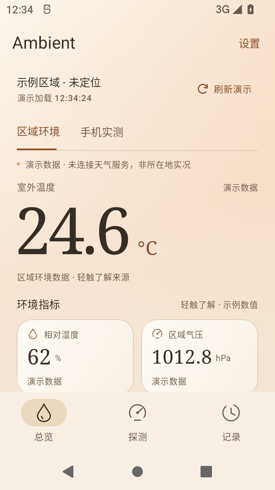
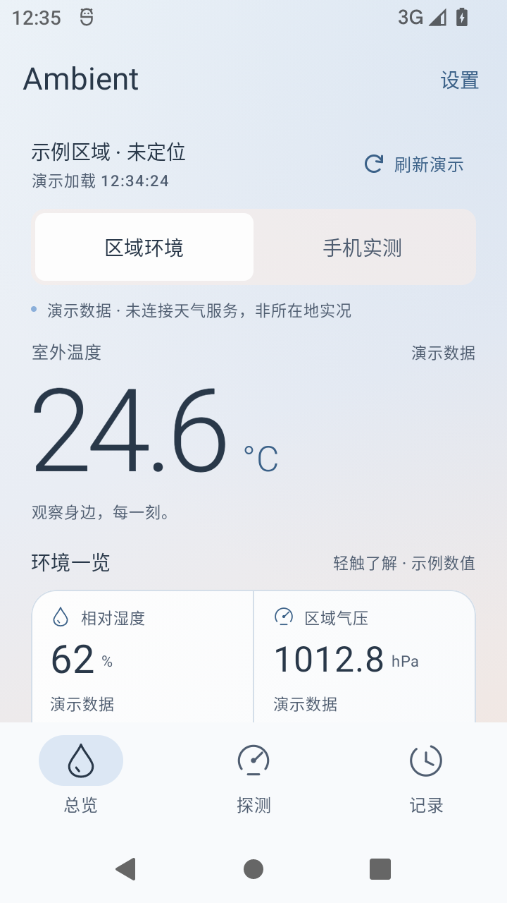
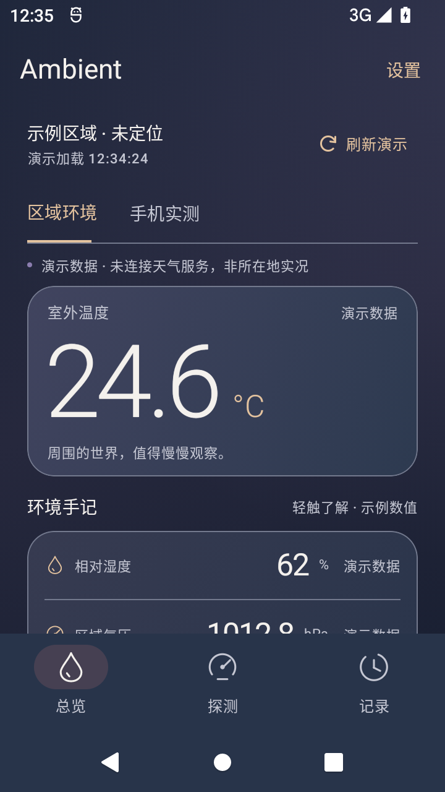

# 三套渐变主题 · 0.2.0

本页保留 0.2.0 的验证证据。标准 APK 路径现为 0.3.0，当前信息见 [加速度与定位速度验证](motion-validation.md)；本页的大小与校验值属于旧版本。

日期：2026-10-15。此版本继续第一阶段，仅落地外观与界面层次，没有接入真实区域天气或扩大传感器采样范围。

## 已完成

- 日光琥珀：奶油白与浅杏渐变、衬线温度数字、独立指标小卡。
- 雾蓝暮色：雾蓝与粉杏渐变、无框大数字、连接指标网格。
- 流光玻璃：深靛与烟紫渐变、玻璃层次主卡、横向指标列表。
- 每套均支持深色、浅色与跟随系统，并保存选择。首次使用默认为流光玻璃深色；旧版本的明暗选择保持。
- 设置中选择主题时应用其推荐明暗外观（日光/暮色浅色，流光深色），下方仍可单独调整。
- 首页改为简短的演示状态与逐项来源，轻触指标查看物理含义。来源与单位至少 11sp，模式切换触控高度至少 48dp。
- 探测、记录、设置和系统栏均跟随主题。传感器生命周期、采样时间戳、限量曲线与每卡片独立订阅保持原逻辑。

背景在 `drawWithCache` 中建立静态线性/径向画笔；卡片为不透明渐变。玻璃效果通过配色、层次和细边实现，没有模糊层、动态背景或持续动画。

## 构建检查

`scripts/build.ps1 -Offline` 完整成功，包含 Debug APK、单元测试及 Android Lint。

- 单元测试：19 项通过，无失败、无错误。原 16 项传感器/缓存测试继续通过；新增 3 项主题测试覆盖六种深浅组合的完整渐变采样、来源小字、控件文字及模式选择，对比度阈值为 4.5:1。
- Lint：`No issues found.`。
- APK：`L:\Ambient\app\build\outputs\apk\debug\app-debug.apk`，包名 `com.ambient.app`，versionCode 2 / versionName 0.2.0，minSdk 26 / targetSdk 36。
- 大小：11,185,140 bytes；SHA-256：`d5661ce9081537afcc13a456107eaedfb5211a2e084c8e04c580ac3f7591e454`。
- Debug APK 签名验证通过。可在原 0.1.0 之上覆盖安装。

## 设备验证

在本项目专用 `Ambient_API_31`（emulator-5560）执行 `scripts/test-themes-emulator.ps1`，逐项验证：

1. 三套主题均能切换，并保存风格及推荐明暗组合。
2. 每套的另一种明暗外观均可独立选择。
3. 三套主题的探测页均能显示模拟器输入的光照事件，并明确标注虚拟传感器。
4. 进入设置后系统中的 Ambient 监听连接注销。
5. 进程终止并重启后保留已选主题和明暗。
6. 跟随系统时，切换 Android 夜间模式会切换 App 外观。
7. 指标详情可打开，保留演示来源及物理说明。
8. 运行中的 Ambient 进程没有 AndroidRuntime 致命异常。

脚本共记录 10 条 PASS 检查点（前三套主题各 2 条，再加重启、系统外观、详情和运行检查）。屏幕为 720×1280 / 320dpi，约 360×640dp。光照是 on-change 传感器，测试会先改变输入再发送目标值，避免把未发生变化的模拟器输入误认为新的事件。

所有截图与读数来自 Android 模拟器，不代表 Pura 70 Pro 真机实测。真机硬件清单、厂商后台行为和功耗尚待验收。

另将专用模拟器切换为 1260×2560 / 480dpi（约 420×853dp）检查三套首页，温度与首组四个环境指标均可见，未观察到文字或单位重叠；截图以 `-large.png` 结尾。此为较大手机视口检查，不等同于复现华为设备。测试后已恢复模拟器默认分辨率。

## 实际原生界面

| 日光琥珀 | 雾蓝暮色 | 流光玻璃 |
| --- | --- | --- |
|  |  |  |

主题设置、各自的反向明暗外观、探测页和跟随系统截图均保存在 `docs/screenshots/themes/`。它们是 APK 的实际运行截图，网页设计稿仍独立保留于聊天预览。

## 建议的下一阶段

先在 Pura 70 Pro 安装此版本，检查传感器、暂停恢复、手势与耗电，再推进“真实区域环境”这一条完整链路：

1. 使用 LocationManager 按需定位，处理拒绝、粗略位置、关闭定位和超时，提供手选区域；不依赖 Google Play Services。
2. 核对和风天气当前接口、专属 API Host、认证及计费，增加个人凭据的安全配置入口；先接通温度、湿度、气压和风，再扩展空气质量与紫外线。UI 通过现有环境服务契约读取数据。
3. 加入持久缓存、最后成功加载时间、真实观测时间、断网回退及部分接口失败状态。演示与真实数据分开，不能混合成一次观测。
4. 海拔继续独立选源并标明高程基准与误差。真实数据链路稳定后，再用 Room/SQLite 实现快照和 CSV。

官方资料：[API 请求配置](https://dev.qweather.com/docs/configuration/api-config/)、[身份认证](https://dev.qweather.com/docs/configuration/authentication/)、[财务与费用](https://dev.qweather.com/docs/finance/)。当前版本没有调用这些接口，没有 API 凭据，也没有增加网络或定位权限。
